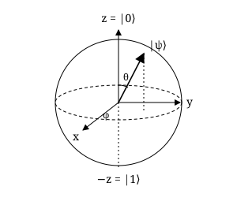

# 2 Kiến thức nền (Background)

## 2.1 Nền tảng toán học (Mathematical Background)

Trong mục này, chúng tôi điểm lại một số khái niệm toán học được dùng xuyên suốt bài báo và một vài chi tiết về ký hiệu.

Ta ký hiệu $\mathbb{Z} = \{\dots, -3, -2, -1, 0, 1, 2, 3, \dots\}$ là tập các số nguyên và $\mathbb{N} = \{0, 1, 2, 3, \dots\}$ là tập các số tự nhiên (số nguyên không âm). Ta dùng ký hiệu $[n] = \{1, 2, \dots, n\}$ để chỉ các số tự nhiên từ 1 đến $n$. Cho $w \in \mathbb{N}^n$ là một bộ gồm $n$ số tự nhiên, ta ký hiệu $|w| = \sum_{j=1}^{n} w_j$ là tổng tất cả các phần tử của bộ đó. Ta cũng sẽ dùng số phức xuyên suốt bài báo và dùng $i = \sqrt{-1}$ để ký hiệu đơn vị ảo. Ta sẽ tránh dùng $i$ làm chỉ số trong các tổng và tích, thay vào đó dùng $j$, $k$ và $\ell$.

*Mũ ma trận* (matrix exponential) của một ma trận vuông $A$ được định nghĩa bằng chuỗi vô hạn sau:

$$e^{A} = \sum_{k=0}^{\infty} \frac{A^k}{k!}, \tag{1}$$

trong đó $A^k$ là lũy thừa bậc $k$ của ma trận $A$, và $k!$ là giai thừa của $k$.

Khi ma trận vuông $A$ chéo hóa được, nó có thể được biểu diễn dưới dạng $A = PDP^{-1}$, trong đó $P$ là ma trận có các cột là các eigenvector của $A$, và $D$ là diagonal matrix chứa các eigenvalue tương ứng của $A$:

$$D = \begin{pmatrix} \lambda_1 & 0 & \cdots & 0 \\ 0 & \lambda_2 & \cdots & 0 \\ \vdots & \vdots & \ddots & \vdots \\ 0 & 0 & \cdots & \lambda_n \end{pmatrix}.$$

Khi đó mũ ma trận có thể được tính bằng

$$e^{A} = P e^{D} P^{-1}, \tag{2}$$

trong đó $e^{D}$ là

$$e^{D} = \begin{pmatrix} e^{\lambda_1} & 0 & \cdots & 0 \\ 0 & e^{\lambda_2} & \cdots & 0 \\ \vdots & \vdots & \ddots & \vdots \\ 0 & 0 & \cdots & e^{\lambda_n} \end{pmatrix}.$$

Khi ma trận $A$ không chéo hóa được, mũ ma trận có thể được tính nhờ dạng chuẩn Jordan của ma trận [36], nhưng ta sẽ không gặp tình huống này trong bài báo.

Ta nói hai ma trận *giao hoán* (commute) nếu $AB = BA$. Ta định nghĩa *giao hoán tử* (commutator) của $A$ và $B$ là $[A, B] = AB - BA$. Nếu hai ma trận $A$ và $B$ giao hoán thì giao hoán tử của chúng bằng $[A, B] = 0$. Khi $A$ và $B$ giao hoán, ta cũng có $e^{A}e^{B} = e^{A+B}$. Nếu $A$ và $B$ không giao hoán, đẳng thức trên không nhất thiết đúng.

Ta sẽ dùng *ký hiệu Dirac* (Dirac's notation) để chỉ các vector $|\psi\rangle$ và các covector $\langle\psi|$. Ta dùng $\otimes$ để chỉ tensor product của hai vector và của hai operator. Vì ta chỉ làm việc với không gian vector của computational basis, $|0\rangle$ và $|1\rangle$, nên ta dùng phép nối chuỗi để ký hiệu tensor product của hai vector. Ví dụ, $|00\rangle = |0\rangle \otimes |0\rangle$. Giả sử ta có operator $A$ tác dụng lên không gian vector $V_1$ và operator $B$ tác dụng lên không gian vector $V_2$, thì tensor product của hai operator này, ký hiệu $A \otimes B$, sẽ tác dụng lên tensor product của các không gian vector $V_1 \otimes V_2$ như sau:

$$(A \otimes B)(|\psi\rangle \otimes |\varphi\rangle) = (A|\psi\rangle) \otimes (B|\varphi\rangle). \tag{3}$$

Một mô hình *Quadratic Unconstrained Binary Optimization* (QUBO) [29] là một pseudo-Boolean function (các đối số là biến nhị phân) có thể viết dưới dạng tổng các term, trong đó mỗi term chứa tích của nhiều nhất hai biến nhị phân. Một cách hình thức:

$$f : \{0, 1\}^n \to \mathbb{R}, \tag{4}$$

$$f(x) = \sum_{j=1}^{n} \sum_{k=1}^{n} Q_{j,k}\, x_j x_k + c, \tag{5}$$

trong đó $Q_{j,k}$ và $c$ là các hằng số, và $x_j$ là biến nhị phân ở vị trí thứ $j$ của vector nhị phân $x$. Các hằng số $Q_{j,k}$ là các phần tử của ma trận $Q$, trong đó giá trị ở hàng $j$, cột $k$ chính là $Q_{j,k}$.

Trong phương trình (5), các term thỏa mãn những điều sau:

- $Q_{j,j}\, x_j x_j$ là các term tuyến tính, vì $x_j^2 = x_j$ do biến $x_j$ là nhị phân.
- $Q_{j,k}$ và $Q_{k,j}$ là các hằng số nhân với cùng một tích các biến $x_j x_k$. Ta có thể viết $(Q_{j,k} + Q_{k,j})\, x_j x_k$. Điều này cho ta thêm một bậc tự do cho mỗi cặp biến nhị phân, có thể tận dụng để đơn giản hóa một số biểu thức. Từ đây trở đi, ta giả sử ma trận $Q$ đối xứng, tức là $Q_{j,k} = Q_{k,j}$.

Ta cũng sẽ làm việc với các *polynomial pseudo-Boolean bậc cao*, trong đó bậc của các term không bị giới hạn ở 1 hoặc 2. Một hàm hữu ích liên quan đến tối ưu pseudo-Boolean là *Iverson bracket*, nhận một giá trị Boolean và trả về 1 nếu nó đúng, 0 nếu nó sai. Hàm này đặc biệt hữu ích để biến một vị từ $P$ thành một pseudo-Boolean function $[P]$. Không nên nhầm Iverson bracket với giao hoán tử của hai ma trận: giao hoán tử có hai đối số, còn Iverson bracket chỉ có một.

Một *mô hình Ising* (Ising model) là một hàm phụ thuộc vào một tập các biến có thể nhận giá trị $-1$ và $1$, ban đầu biểu diễn các hệ lượng tử có spin 1/2. Dạng tổng quát là

$$f : \{-1, 1\}^n \to \mathbb{R}, \tag{6}$$

$$f(s) = \sum_{j=1}^{n} \sum_{k=1}^{n} J_{j,k}\, s_j s_k + \sum_{j=1}^{n} h_j s_j, \tag{7}$$

trong đó $J_{j,k}$ và $h_j$ là các hằng số, và $s_j$ là biến thứ $j$ của vector $s$. Ta có thể xem $J$ là một ma trận và $h$ là một vector. Mọi phần tử trên đường chéo của ma trận $J$ chỉ làm dịch hàm đi một hằng số vì $s_j^2 = 1$. Do đó, ta giả sử mọi phần tử $J_{j,j} = 0$, trừ $J_{1,1}$.

Các mô hình QUBO và Ising là tương đương. Ta có thể dễ dàng chuyển từ cái này sang cái kia bằng phép thế biến $x_j = (1 - s_j)/2$. Ta đặc biệt quan tâm đến việc chuyển QUBO sang mô hình Ising. Ta có thể làm điều này bằng các biểu thức

$$J_{j,k} = \frac{1}{4} Q_{j,k}, \quad \text{với } j \neq k, \tag{8}$$

$$J_{1,1} = c + \frac{1}{4} \sum_{j,k} Q_{j,k} + \frac{1}{4} \sum_{j=1}^{n} Q_{j,j}, \tag{9}$$

$$J_{j,j} = 0 \quad \text{với } j = 2, \dots, n, \tag{10}$$

$$h_j = -\frac{1}{2} \sum_{k=1}^{n} Q_{j,k}, \tag{11}$$

trong đó ta đã giả sử ma trận $Q$ của QUBO là đối xứng.

Trừ khi có nói khác, xuyên suốt bài báo ta giả sử mọi hàm mục tiêu đều được **cực tiểu hóa**. Nếu muốn cực đại hóa một hàm mục tiêu $f$, ta chỉ cần nhân $f$ với $-1$ để cực tiểu hóa $-f$.

> **Ghi chú người dịch:**
> - Phép thế $x_j = (1 - s_j)/2$ tương đương $s_j = (-1)^{x_j}$: $x_j = 0 \mapsto s_j = 1$, $x_j = 1 \mapsto s_j = -1$. Chiều này quan trọng ở §6, vì $Z|x\rangle = (-1)^x |x\rangle$.
> - Các công thức (8)–(11) được suy ra bằng cách thế $x_j x_k = (1 - s_j - s_k + s_j s_k)/4$ vào (5) và dùng $Q$ đối xứng. Phần dẫn từng bước có ở [B-02a](../B-extensions/02-math-and-qubo-ising.md).

---

## 2.2 Quantum annealers

Ở Mục 1, chúng tôi đã nêu rằng tính toán lượng tử có thể được phân thành hai mô hình chính: gate-based và adiabatic. Quantum annealer là một hiện thực cụ thể của mô hình thứ hai. Mục này sẽ bắt đầu bằng việc mô tả mô hình adiabatic, rồi giải thích cách các quantum annealer hoạt động như một cơ chế tối ưu.

*Adiabatic theorem* [9] là một khái niệm then chốt, làm nền tảng cho tính toán lượng tử adiabatic. Về cơ bản, định lý khẳng định rằng một hệ lượng tử sẽ giữ nguyên ở state energy thấp nhất hiện tại của nó nếu Hamiltonian chi phối thay đổi với tốc độ đủ chậm, và nếu trong suốt quá trình có một chênh lệch energy đáng kể giữa mức energy thấp nhất và state energy cao kế tiếp. Nếu $H(t)$ là Hamiltonian biến thiên theo thời gian và $|\psi(t)\rangle$ là ground state tại một thời điểm nào đó, hệ sẽ vẫn ở trong $|\psi(t)\rangle$ miễn là tốc độ thay đổi của $H(t)$ chậm hơn đáng kể so với nghịch đảo bình phương của *energy gap* nhỏ nhất [25]. Ý tưởng này là thiết yếu trong tính toán lượng tử adiabatic, vì nó đảm bảo rằng state cuối cùng của hệ, sau một quá trình tiến hóa chậm, sẽ là state energy thấp nhất của Hamiltonian cuối. Do đó, nó biểu diễn solution của bài toán tính toán được mã hóa trong Hamiltonian đó.

*Adiabatic quantum computing* (AQC) [1] tận dụng adiabatic theorem để tối ưu. Nó khởi tạo một hệ lượng tử ở ground state của một Hamiltonian $H_0$ đã biết rõ, rồi cho Hamiltonian tiến hóa chậm đến một Hamiltonian cuối $H_P$ biểu diễn bài toán tối ưu cần cực tiểu hóa. Theo adiabatic theorem, khi kết thúc quá trình tiến hóa, hệ sẽ ở trong ground state của Hamiltonian cuối, tức là solution của bài toán đang xét.

*Quantum annealer* là một dạng chuyên biệt của máy tính lượng tử adiabatic, dùng quá trình quantum annealing để giải bài toán. Quantum annealing [27] là một biến thể của *simulated annealing* cổ điển [28], một phương pháp tối ưu ngẫu nhiên mô phỏng quá trình ủ trong luyện kim. Theo cách này, quantum annealing bắt đầu bằng việc đặt hệ vào một superposition của mọi state có thể. Sau đó, nó trải qua một quá trình chuyển đổi chậm sang state có energy thấp nhất của Hamiltonian cuối ($H_P$). *Quantum tunneling* cho phép hệ di chuyển giữa các state energy khi Hamiltonian tiến hóa, nhờ đó vượt qua các rào energy vốn sẽ giam các hệ cổ điển trong các local minimum.

Như vậy, các quantum annealer chủ yếu được phân biệt bởi quá trình tiến hóa adiabatic của chúng, nhằm tối ưu một hàm cho trước. Có một số khác biệt quan trọng so với AQC. Chủ yếu là, quantum annealer bắt đầu ở một state ban đầu được chọn ngẫu nhiên, thường là một superposition đều, và hệ có thể ban đầu không ở trong ground state và không bắt buộc phải duy trì ở ground state trong suốt quá trình tiến hóa.

---

## 2.3 Máy tính lượng tử gate-based (Gate-based quantum computers)

Bây giờ ta chuyển sang mô hình gate-based. Cách tiếp cận này giống tính toán cổ điển hơn mô hình adiabatic, vì nó dùng các phép toán rời rạc, tương tự các gate logic cổ điển. Tuy nhiên, nó khác biệt về căn bản ở chỗ khai thác superposition và entanglement, từ đó có khả năng đạt tăng tốc theo hàm mũ cho một số bài toán nhất định.

Mô hình này mô tả các phép tính dưới dạng các *quantum circuit* gồm một chuỗi các *quantum gate* tác dụng lên các qubit (qubit). State $|\psi\rangle$ của một qubit nói chung là một superposition của hai state cơ sở $|0\rangle$ và $|1\rangle$, trong đó $|\psi\rangle = \alpha|0\rangle + \beta|1\rangle$ với $\alpha, \beta \in \mathbb{C}$. Chúng cũng thỏa điều kiện chuẩn hóa $|\alpha|^2 + |\beta|^2 = 1$.

*Bloch sphere* (xem Hình 1) là một biểu diễn hình học hữu ích của không gian các state thuần của một hệ cơ lượng tử hai mức (qubit). Mỗi điểm trên mặt cầu ứng với một state thuần duy nhất của qubit. State $|\psi\rangle$ có thể được viết, không mất tính tổng quát, dưới dạng

$$|\psi\rangle = \cos\left(\frac{\theta}{2}\right)|0\rangle + e^{i\varphi}\sin\left(\frac{\theta}{2}\right)|1\rangle,$$

trong đó $\theta$ và $\varphi$ là các tọa độ cầu.

  
   
  <em>Hình 1: Biểu diễn Bloch sphere của một state qubit.</em>

State lượng tử của một hệ nhiều qubit có thể được biểu diễn bằng tensor product của các state lượng tử của từng qubit: $|\psi\rangle = \sum_{w \in \{0,1\}^n} a_w |w\rangle$, trong đó $w \in \{0, 1\}^n$ và $a_w \in \mathbb{C}$. Như vậy, mỗi state lượng tử trong một hệ $n$ qubit được biểu diễn bằng một bộ gồm $2^n$ số phức.

Mỗi quantum gate được biểu diễn bởi một phép biến đổi *unitary* $U : \mathbb{C}^{2^n} \to \mathbb{C}^{2^n}$, thỏa $U^\dagger U = UU^\dagger = I$, trong đó $U^\dagger$ là liên hợp Hermite của $U$ và $I$ là ma trận đơn vị. Có nhiều quantum gate khác nhau [33]. Tiếp theo ta mô tả những gate quan trọng nhất trong bài báo này.

**Hadamard gate**, ký hiệu H, là single-qubit gate ánh xạ các state cơ sở $|0\rangle$ và $|1\rangle$ thành các superposition đều của hai state đó. Nó được biểu diễn bởi ma trận:

$$H = \frac{1}{\sqrt{2}} \begin{pmatrix} 1 & 1 \\ 1 & -1 \end{pmatrix}.$$

Hadamard gate được dùng để tạo superposition và là gate nền tảng của nhiều thuật toán lượng tử. Ví dụ, khi áp dụng lên một qubit ở state $|0\rangle$, nó tạo ra state $\frac{1}{\sqrt{2}}(|0\rangle + |1\rangle)$.

**Pauli-X gate**, còn gọi là NOT gate lượng tử, tương tự NOT gate cổ điển và thiết yếu để tạo các phép đảo và các phép toán đòi hỏi lật state. NOT gate lật state của một qubit: nó biến $|0\rangle$ thành $|1\rangle$ và $|1\rangle$ thành $|0\rangle$. Ma trận biểu diễn của NOT gate là

$$\sigma_x = \begin{pmatrix} 0 & 1 \\ 1 & 0 \end{pmatrix}.$$

Cổng **RX** là phép quay quanh trục X của Bloch sphere. Nó được biểu diễn bởi ma trận

$$R_X(\theta) = e^{-i\frac{\theta}{2}\sigma_x} = \begin{pmatrix} \cos(\theta/2) & -i\sin(\theta/2) \\ -i\sin(\theta/2) & \cos(\theta/2) \end{pmatrix}.$$

**Pauli-Y gate** thực hiện đồng thời một phép lật bit và một phép lật pha. Nó được biểu diễn bởi ma trận

$$\sigma_y = \begin{pmatrix} 0 & -i \\ i & 0 \end{pmatrix},$$

trong đó $i$ là đơn vị ảo. Cổng này biến $|0\rangle$ thành $i|1\rangle$ và $|1\rangle$ thành $-i|0\rangle$. Cổng **RY** là phép quay quanh trục Y của Bloch sphere. Nó được biểu diễn bởi ma trận

$$R_Y(\theta) = e^{-i\frac{\theta}{2}\sigma_y} = \begin{pmatrix} \cos(\theta/2) & -\sin(\theta/2) \\ \sin(\theta/2) & \cos(\theta/2) \end{pmatrix}.$$

**Pauli-Z gate**, còn gọi là phase-flip gate, đổi dấu state $|1\rangle$ nhưng giữ nguyên state $|0\rangle$. Nó được đặc trưng bởi diagonal matrix

$$\sigma_z = \begin{pmatrix} 1 & 0 \\ 0 & -1 \end{pmatrix}.$$

Cổng này giữ vai trò trung tâm trong việc xây dựng Hamiltonian biểu diễn các mô hình Ising. Tác dụng của nó lên computational basis có thể được biểu diễn đại số bằng biểu thức $Z|x\rangle = (-1)^x |x\rangle$, với $x \in \{0, 1\}$. Cổng **RZ** là phép quay quanh trục Z của Bloch sphere. Nó được biểu diễn bởi ma trận

$$R_Z(\theta) = e^{-i\frac{\theta}{2}\sigma_z} = \begin{pmatrix} e^{-i\theta/2} & 0 \\ 0 & e^{i\theta/2} \end{pmatrix}.$$

**Controlled-NOT (CNOT) gate** là two-qubit gate thực hiện phép NOT lên qubit đích chỉ khi qubit điều khiển ở state $|1\rangle$. Ma trận biểu diễn của nó trong computational basis là

$$\mathrm{CNOT} = \begin{pmatrix} 1 & 0 & 0 & 0 \\ 0 & 1 & 0 & 0 \\ 0 & 0 & 0 & 1 \\ 0 & 0 & 1 & 0 \end{pmatrix}.$$

CNOT gate thiết yếu để tạo entanglement giữa các qubit, một tài nguyên then chốt của tính toán lượng tử.

Tập gồm các RX gate, RY, RZ cùng CNOT gate là một *tập operator phổ quát* (universal set of operators), nghĩa là mọi phép biến đổi unitary đều có thể được biểu diễn bằng một quantum circuit chỉ chứa các gate này.

Một thao tác quan trọng (không phải operator) trong máy tính lượng tử gate-based là *measurement*. Thao tác measurement làm state lượng tử sụp về một trong các state cơ sở, cho ra một chuỗi bit cổ điển làm kết quả. Khi đo một máy tính lượng tử ở state $|\psi\rangle = \sum_{w \in \{0,1\}^n} a_w |w\rangle$, xác suất thu được chuỗi nhị phân $w$ là $|a_w|^2$. Kết quả của measurement làm qubit sụp về state đo được $|w\rangle$. Measurement đóng vai trò quyết định để rút thông tin từ các phép tính lượng tử, vì nó là cầu nối giữa thế giới lượng tử và thế giới cổ điển.
