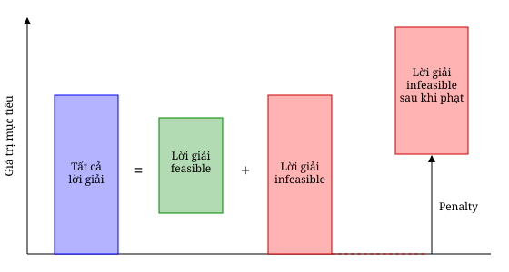

# 4 Biến đổi bài toán tối ưu (Transforming the optimization problem)

Cả quantum annealer lẫn máy tính lượng tử gate-based đều cần bài toán tối ưu được biểu diễn dưới dạng một hàm pseudo-Boolean không ràng buộc. Vì vậy, trong mục này chúng tôi mô tả cách biến một bài toán tối ưu tổ hợp bất kỳ, từng bước một, thành một hàm pseudo-Boolean không có ràng buộc.

## 4.1 Biểu diễn lời giải (Solution Representation)

Bước đầu tiên khi giải một bài toán tối ưu bằng máy tính lượng tử là quyết định cách biểu diễn các lời giải của bài toán trong máy lượng tử. Phần lớn máy tính lượng tử ngày nay dựa trên qubit, có thể được biểu diễn bởi một không gian Hilbert 2 chiều. Có một số máy dựa trên *qudit* [13], với số trạng thái cơ sở nhiều hơn (qutrit, ququad, v.v.), nhưng ở đây chúng tôi tập trung vào các máy phổ biến nhất, dựa trên qubit. Lời giải của các bài toán tối ưu pseudo-Boolean có thể được biểu diễn một cách tự nhiên nhờ qubit, và ở bước này không cần làm gì thêm.

**Ví dụ 3.** Trong bài toán MAX-SAT, mỗi biến Boolean có thể được ánh xạ vào một qubit của máy. $\square$

**Biến nguyên (Integer variables).** Khi có các biến nguyên, ta cần biểu diễn mỗi biến bằng nhiều biến Boolean. Trong trường hợp này, ta cần giới hạn miền giá trị của biến nguyên để có một biểu diễn hữu hạn của biến đó. Hãy bắt đầu với một trường hợp đơn giản. Hình dung biến nguyên $z \in \mathbb{Z}$ nhận giá trị trong khoảng $[0, 2^n - 1]$, khi đó ta có thể dùng $n$ biến Boolean $x_j$ với $j \in [n]$ để biểu diễn $z$ như cách máy tính cổ điển vẫn làm:

$$z = \sum_{j=0}^{n-1} 2^j x_{j+1}. \tag{18}$$

Lưu ý rằng ta đánh số các biến bắt đầu từ 1: $x_1$, $x_2$, v.v. Thay $z$ bằng biểu thức theo $x_j$ cho bởi phương trình (18) trong mọi biểu thức, ta có thể loại bỏ biến nguyên $z$ và thêm $n$ biến Boolean mới.

**Ví dụ 4.** Cho $z \in [0, 7]$ là một biến nguyên của một bài toán tối ưu. Ta có thể đưa vào ba biến Boolean $x_1$, $x_2$ và $x_3$ để biểu diễn $z$ là $z = x_1 + 2x_2 + 4x_3$. Giá trị $z = 5$ được biểu diễn bởi $x_1 = 1$, $x_2 = 0$, $x_3 = 1$. $\square$

Nếu miền giá trị của $z$ là $[0, 2^n - 1 - b]$ với $b > 0$, thì phương trình (18) có thể cho các giá trị của $z$ nằm ngoài miền. Để tránh vi phạm ràng buộc miền này, ta có thể giảm trọng số của bit "có ý nghĩa nhất" $x_n$. Ta có thể yên tâm giả sử $b < 2^{n-1}$, nếu không thì $z$ có thể được biểu diễn bằng $n - 1$ biến Boolean thay vì $n$. Trong trường hợp này, ta có thể biểu diễn $z$ một cách tổng quát bằng biểu thức

$$z = (2^{n-1} - b)\, x_n + \sum_{j=0}^{n-2} 2^j x_{j+1}, \tag{19}$$

tương đương với phương trình (18) khi $b = 0$.

**Ví dụ 5.** Giả sử $z \in [0, 5]$. Ta cần $n = 3$ biến để biểu diễn $z$ và $b = 2$. Ta dùng ba biến Boolean $x_1$, $x_2$ và $x_3$ và biểu diễn $z$ là $z = x_1 + 2x_2 + 2x_3$. Giá trị $z = 5$ được biểu diễn bởi $x_1 = 1$, $x_2 = 1$, $x_3 = 1$, còn $z = 3$ có hai cách biểu diễn: $x_1 = 1$, $x_2 = 1$, $x_3 = 0$; và $x_1 = 1$, $x_2 = 0$, $x_3 = 1$. $\square$

Miền giá trị tổng quát nhất của một biến nguyên có dạng $[a, c]$. Trong trường hợp này, ta cần $n = \lceil \log_2(c - a + 1) \rceil$ biến Boolean. Khoảng này có thể được viết lại một cách thuận tiện thành $[a, a + 2^n - 1 - b]$, với $0 \le b < 2^{n-1}$. Khi đó ta có thể viết $z$ theo $n$ biến Boolean mới như sau:

$$z = a + (2^{n-1} - b)\, x_n + \sum_{j=0}^{n-2} 2^j x_{j+1}. \tag{20}$$

**Ví dụ 6.** Giả sử $z \in [-3, 3]$. Ta cần $n = \lceil \log_2(3 - (-3) + 1) \rceil = \lceil \log_2 7 \rceil = 3$ biến để biểu diễn $z$. Ta có $a = -3$ và $b = 1$. Ta dùng ba biến Boolean $x_1$, $x_2$ và $x_3$ và biểu diễn $z$ là $z = -3 + x_1 + 2x_2 + 3x_3$. Giá trị $z = -1$ được biểu diễn bởi $x_1 = 0$, $x_2 = 1$, $x_3 = 0$, còn $z = 0$ có hai cách biểu diễn: $x_1 = 1$, $x_2 = 1$, $x_3 = 0$; và $x_1 = 0$, $x_2 = 0$, $x_3 = 1$. $\square$

**Biến phân loại và hoán vị (Categorical Variables and Permutations).** Một biến $y$ được gọi là *phân loại* (categorical) khi nó nhận giá trị từ một tập hữu hạn các lựa chọn $L = \{\ell_1, \ell_2, \dots, \ell_k\}$, còn gọi là các *level*. Ta có thể biểu diễn biến này bằng mã hóa nhị phân bằng cách đưa vào một biến nhị phân $x_\ell$ cho mỗi level $\ell$. Biến này bằng 1 khi và chỉ khi biến phân loại ban đầu được gán level đó. Dạng mã hóa này, gọi là *one-hot encoding*, còn đòi hỏi tổng các biến của mọi level bằng 1:

$$\sum_{\ell \in L} x_\ell = 1. \tag{21}$$

**Ví dụ 7.** Bài toán *tô màu đồ thị* (Graph Coloring Problem) [26] là gán một màu cho mỗi đỉnh của đồ thị $G(V, E)$ sao cho các nút kề nhau có màu khác nhau. Phiên bản tối ưu của bài toán này cực tiểu hóa số nút kề nhau có cùng màu. Giả sử ta giải một thể hiện của bài toán tô màu đồ thị với tập màu là $\{red, blue, green\}$. Ta có thể dùng một biến phân loại $y_j$ cho mỗi nút $j \in V$. Nếu dùng one-hot encoding để biểu diễn lời giải bằng các biến nhị phân, ta có thể tạo ba biến cho mỗi nút, $x_{j,red}$, $x_{j,blue}$ và $x_{j,green}$, và yêu cầu

$$x_{j,red} + x_{j,blue} + x_{j,green} = 1 \quad \forall j \in V. \tag{22}$$

$\square$

Một *hoán vị* (permutation) $\sigma$ kích thước $n$ là một dãy các số từ 1 đến $n$ trong đó không số nào lặp lại. Ta dùng ký hiệu $\sigma(j)$ để chỉ giá trị ở vị trí $j$ trong hoán vị $\sigma$. Ta cũng có thể dùng one-hot encoding để biểu diễn hoán vị. Với mỗi hoán vị $\sigma$, ta có thể đưa vào một tập gồm $n^2$ biến $x_{j,k}$ nhận giá trị 1 khi và chỉ khi $\sigma(j) = k$. Tương tự các biến phân loại, ta yêu cầu mỗi vị trí trong hoán vị chỉ nhận đúng một giá trị:

$$\sum_{k=1}^{n} x_{j,k} = 1 \quad \forall j \in [n]. \tag{23}$$

Ràng buộc thứ hai của hoán vị là các số không được lặp lại trong dãy:

$$\sum_{j=1}^{n} x_{j,k} = 1 \quad \forall k \in [n]. \tag{24}$$

**Ví dụ 8.** Bài toán *người bán hàng rong* nổi tiếng (Traveling Salesperson Problem, TSP) [2] là tìm một thứ tự thăm một tập $n$ thành phố sao cho mỗi thành phố được thăm một lần và chỉ một lần, và tổng độ dài hành trình là nhỏ nhất. Một lời giải của bài toán này thường được biểu diễn bởi một hoán vị $\sigma$. Ta có thể đưa vào các biến nhị phân $x_{j,k}$ bị ràng buộc bởi các phương trình (23) và (24) để biểu diễn các lời giải của bài toán. $\square$

---

## 4.2 Hàm mục tiêu (Objective Function)

Khi đã đưa vào các biến nhị phân cần thiết để biểu diễn lời giải, ta cần thay các biến ban đầu bằng các biến nhị phân trong hàm mục tiêu. Nếu các biến ban đầu đã là nhị phân, ta chỉ cần biểu diễn hàm mục tiêu dưới dạng biểu thức pseudo-Boolean. Hãy minh họa điều này với thể hiện MAX-SAT ở Ví dụ 2.

**Ví dụ 9.** Một clause logic của một thể hiện MAX-SAT chỉ không được thỏa khi mọi literal đều sai, và được thỏa trong các trường hợp còn lại. Xét clause đầu tiên của thể hiện ở Ví dụ 2: $x_1 \lor \neg x_2 \lor x_3$. Clause này không được thỏa khi $x_1 = 0$, $x_2 = 1$ và $x_3 = 0$. Ta có thể xây dựng một đa thức bậc ba bằng 1 khi clause không được thỏa: $(1 - x_1)\,x_2\,(1 - x_3)$. Biểu thức này là một tích trong đó các biến bị phủ định xuất hiện nguyên dạng và các literal dương xuất hiện dưới dạng bù. Hàm mục tiêu của MAX-SAT là tổng các biểu thức này trên mọi clause. Trong ví dụ của ta,

$$\begin{aligned} f(x) &= (1 - x_1)\,x_2\,(1 - x_3) \\ &\quad + (1 - x_1)(1 - x_2)\,x_3 \\ &\quad + x_1 x_2 (1 - x_3) \\ &= x_1 x_2 x_3 - 2x_2 x_3 - x_1 x_3 + x_2 + x_3. \end{aligned} \tag{25}$$

$\square$

Nếu hàm ban đầu có các biến nguyên, ta thay các biến nguyên bằng các biểu thức nhị phân tương ứng và khai triển biểu thức, lưu ý rằng với mỗi biến nhị phân $x$ ta có $x^k = x$ với $k \ge 1$. Điều này nghĩa là ta có thể đơn giản hóa các biểu thức để đạt được các đơn thức đa tuyến tính (multilinear), tức là các số hạng tuyến tính theo mọi biến.

**Ví dụ 10.** Giả sử hàm mục tiêu của ta là $f(z) = z^3 - 6z$ với $z$ nguyên và $z \in [-3, 3]$. Theo Ví dụ 6, ta cần đưa vào ba biến nhị phân để biểu diễn $z$ và biểu diễn nó là $z = -3 + x_1 + 2x_2 + 3x_3$. Áp dụng phép đổi biến này vào hàm mục tiêu, ta được

$$\begin{aligned} f(x) &= (-3 + x_1 + 2x_2 + 3x_3)^3 - 6\,(-3 + x_1 + 2x_2 + 3x_3) \\ &= x_1^3 + 6x_2 x_1^2 + 9x_3 x_1^2 - 9x_1^2 + 12x_2^2 x_1 + 27x_3^2 x_1 - 36x_2 x_1 + 36x_2 x_3 x_1 \\ &\quad - 54x_3 x_1 + 21x_1 + 8x_2^3 + 27x_3^3 - 36x_2^2 + 54x_2 x_3^2 - 81x_3^2 + 42x_2 + 36x_2^2 x_3 \\ &\quad - 108x_2 x_3 + 63x_3 - 9 \end{aligned}$$

dùng $x^k = x$ với $k \ge 1$

$$\begin{aligned} &= x_1 + 6x_2 x_1 + 9x_3 x_1 - 9x_1 + 12x_2 x_1 + 27x_3 x_1 - 36x_2 x_1 + 36x_2 x_3 x_1 \\ &\quad - 54x_3 x_1 + 21x_1 + 8x_2 + 27x_3 - 36x_2 + 54x_2 x_3 - 81x_3 + 42x_2 + 36x_2 x_3 \\ &\quad - 108x_2 x_3 + 63x_3 - 9 \\ &= -9 + 13x_1 + 14x_2 + 9x_3 - 18x_1 x_2 - 18x_1 x_3 - 18x_2 x_3 + 36x_1 x_2 x_3 \end{aligned}$$

$\square$

Khi bài toán có các biến phân loại, một cách rất tổng quát để biểu diễn hàm mục tiêu là dùng các hàm con dựa trên các vị từ (predicate) chứa các biến phân loại. Các hàm con này có thể được viết là

$$f(u, v) = \begin{cases} \alpha & \text{nếu } P(u, v) \text{ đúng,} \\ \beta & \text{ngược lại,} \end{cases} \tag{26}$$

trong đó $\alpha, \beta$ là các số thực, và $P(u, v)$ là một vị từ của các biến phân loại $u$ và $v$. Ta có thể viết phương trình (26) gọn hơn thành $f(u, v) = (\alpha - \beta)[P(u, v)] + \beta$ bằng Iverson bracket. Để thay các biến phân loại bằng các biến nhị phân, ta chỉ cần đưa ra các biểu thức cho Iverson bracket. Các biểu thức này sẽ phụ thuộc vào cấu trúc của vị từ. Bảng 1 đưa ra một định nghĩa đệ quy của Iverson bracket, trong đó trường hợp cơ sở luôn phụ thuộc vào các biến nhị phân.

*Bảng 1: Định nghĩa đệ quy của Iverson bracket cho các vị từ có biến phân loại. Ở hai hàng cuối, $u$ và $v$ là hai biến phân loại có cùng các level. Các biến nhị phân $x$ gắn với biến phân loại $u$, còn các biến nhị phân $y$ gắn với biến phân loại $v$.*

| Vị từ | Hàm |
|---|---|
| $[P \lor Q]$ | $[P] + [Q] - [P][Q]$ |
| $[P \land Q]$ | $[P][Q]$ |
| $[\neg P]$ | $1 - [P]$ |
| $[u = \ell]$ | $x_\ell$ |
| $[v = u]$ | $\sum_{\ell \in L} x_\ell y_\ell$ |

**Ví dụ 11.** Hãy viết hàm mục tiêu cho bài toán tô màu đồ thị đã định nghĩa ở Ví dụ 7. Với mỗi cạnh $(j, k) \in E$ của đồ thị, ta cần một hàm con nhận giá trị 1 nếu hai nút kề nhau có cùng màu và 0 nếu có màu khác nhau. Gọi $u_j$ là biến phân loại chỉ màu của nút $j$. Hàm mục tiêu ban đầu là

$$f(u) = \sum_{(j,k) \in E} [u_j = u_k], \tag{27}$$

và dùng các biến nhị phân ta có thể viết

$$f(x) = \sum_{(j,k) \in E} \sum_{\ell \in L} x_{j,\ell}\, x_{k,\ell}, \tag{28}$$

trong đó $L$ là tập các màu có thể có. Như đã giải thích ở Ví dụ 7, ta cũng cần thêm một phương trình ứng với ràng buộc mỗi nút có một và chỉ một màu: $\sum_{\ell \in L} x_{j,\ell} = 1$ với mọi $j \in V$. $\square$

Ta cũng có thể xây dựng hàm mục tiêu của một bài toán hoán vị bằng Iverson bracket. Nếu $P(\sigma)$ là một vị từ dựa trên hoán vị $\sigma$, ta có thể dùng các hàm con có dạng $f(\sigma) = (\alpha - \beta)[P(\sigma)] + \beta$ để viết hàm mục tiêu. Một vị từ hoán vị rất phổ biến là $\sigma(i) = j$. Ta có thể gặp vị từ này trong các bài toán như bài toán người bán hàng rong (TSP) [2] và *bài toán gán bậc hai* (Quadratic Assignment Problem, QAP) [10].

**Ví dụ 12.** Hàm mục tiêu của *bài toán gán tuyến tính* (Linear Assignment Problem) có thể được viết là

$$f(\sigma) = \sum_{j=1}^{n} c_{j,\sigma(j)}. \tag{29}$$

Dùng Iverson bracket, ta có thể viết

$$f(\sigma) = \sum_{j=1}^{n} \sum_{k=1}^{n} c_{j,k}\, [\sigma(j) = k]. \tag{30}$$

Bây giờ ta có thể để ý rằng biến nhị phân $x_{j,k}$ bằng 1 khi và chỉ khi $\sigma(j) = k$, theo định nghĩa. Điều này nghĩa là $x_{j,k} = [\sigma(j) = k]$ và cuối cùng ta viết hàm mục tiêu dưới dạng biểu thức pseudo-Boolean

$$f(x) = \sum_{j=1}^{n} \sum_{k=1}^{n} c_{j,k}\, x_{j,k}, \tag{31}$$

trong đó ta cần thêm các ràng buộc ứng với hoán vị: các phương trình (23) và (24). $\square$

> **Ghi chú người dịch:** Các kết quả khai triển ở Ví dụ 9 và 10 đã được kiểm tra lại bằng cách tính giá trị trên mọi tổ hợp nhị phân (chương trình duyệt vét cạn); các biểu thức cuối đều khớp với hàm gốc.

---

## 4.3 Ràng buộc (Constraints)

Các hàm pseudo-Boolean mà máy tính lượng tử có thể tối ưu là các hàm không ràng buộc. Bước tiếp theo trong việc biến đổi bài toán tối ưu của ta là đưa các ràng buộc của bài toán vào hàm mục tiêu cuối cùng. Ta nói một lời giải của bài toán là **khả thi** (feasible) khi nó thỏa mọi ràng buộc và **không khả thi** (infeasible) khi nó không thỏa ít nhất một ràng buộc. Để kết hợp các ràng buộc và hàm mục tiêu thành một biểu thức duy nhất cần cực tiểu hóa, ta đưa vào các *biểu thức phạt* (penalty expression) làm tăng giá trị hàm mục tiêu nếu lời giải là infeasible. Ta minh họa bước này ở Hình 2.

  
   
  <em>Hình 2: Các lời giải trong bài toán của ta có thể được phân thành feasible và infeasible. Để xây dựng một biểu thức duy nhất cho hàm mục tiêu, ta cần đảm bảo mọi lời giải infeasible có giá trị mục tiêu lớn hơn lời giải feasible tốt nhất. Ta làm điều này bằng cách cộng các biểu thức phạt vào hàm mục tiêu.</em>

Các biểu thức trong ràng buộc của một bài toán tối ưu phải được biến đổi theo các bước giống như ở Mục 4.1 và 4.2. Hãy tập trung vào một ràng buộc và giả sử nó là một đẳng thức $h(x) = 0$. Ta cũng giả sử $h(x)$ nhận giá trị nguyên.4 Khi đó, $h^2(x)$ là một biểu thức phạt phù hợp, sẽ bằng 0 nếu ràng buộc được thỏa và lớn hơn 0 trong trường hợp ngược lại. Ta thường cần nhân $h^2(x)$ với một *hằng số phạt* $P$ để tránh bất kỳ sự chồng lấn nào giữa các lời giải infeasible và các lời giải feasible tốt nhất (Hình 2). Ta sẽ trình bày chi tiết ở phần sau của mục này cách ước lượng hằng số $P$.

Nếu ràng buộc là một bất đẳng thức $h(x) \le 0$, ta biến nó thành một ràng buộc đẳng thức bằng một *slack variable*. Cụ thể, ta đưa vào một biến nguyên không âm $s \in \mathbb{Z}$ với $s \ge 0$ và thay bất đẳng thức bằng ràng buộc đẳng thức $h(x) + s = 0$, được biến thành biểu thức phạt $(h(x) + s)^2$, trong đó $s$ cần được thay bằng các biến nhị phân thích hợp. Giá trị lớn nhất của $s$ sẽ bằng $-\min_{x \in \{0,1\}^n} h(x)$. Giá trị này giúp ta xác định biểu diễn nhị phân của $s$ theo các bước ở Mục 4.1.

4 *Nếu các hệ số của $h(x)$ có số thập phân, ta có thể nhân cả hàm với một số nguyên đủ lớn để chỉ còn hệ số nguyên.*

**Ví dụ 13.** Nếu ta thêm ràng buộc $3x_1 x_4 x_6 - 4x_3 x_5 \le 0$ vào bài toán tối ưu, một biểu thức phạt khả dĩ là $(3x_1 x_4 x_6 - 4x_3 x_5 + s)^2$. Dễ thấy $\min_{x \in \{0,1\}^n} (3x_1 x_4 x_6 - 4x_3 x_5) = -4$, và do đó slack variable $s$ cần thỏa $0 \le s \le 4$. Ta cần ba biến nhị phân mới để biểu diễn $s$, gọi chúng là $t_1$, $t_2$ và $t_3$. Biến $s$ có thể được thay bằng $t_1 + 2t_2 + t_3$ và biểu thức phạt cuối cùng là

$$P\,(3x_1 x_4 x_6 - 4x_3 x_5 + t_1 + 2t_2 + t_3)^2, \tag{32}$$

trong đó $P$ sẽ phụ thuộc vào hàm mục tiêu của bài toán. $\square$

Về hằng số phạt $P$, người đọc quan tâm có thể tìm thấy các công trình nghiên cứu dành riêng cho việc xác định giá trị của hằng số này [3]. Ở đây chúng tôi sẽ đưa ra một quy tắc tìm giá trị dùng được, nhưng không nhất thiết là tốt nhất để giải một bài toán tối ưu. Ý tưởng của quy tắc là tập trung vào hàm mục tiêu $f(x)$, ở bước này là một đa thức pseudo-Boolean

$$f(x) = \sum_{S \subseteq [n]} a_S \prod_{j \in S} x_j. \tag{33}$$

Bây giờ ta khẳng định rằng một hằng số phạt $P$ dùng được là hiệu giữa cận trên và cận dưới của $f$ cộng một: $P = ub(f) - lb(f) + 1$. Lý do như sau. Ta biết một lời giải tối ưu (feasible) của bài toán tối ưu, ký hiệu $x^*$, nằm giữa cận dưới và cận trên: $lb(f) \le f(x^*) \le ub(f)$. Gọi $y$ là một lời giải infeasible. Ta cũng có $lb(f) \le f(y) \le ub(f)$, nhưng ta không biết thứ tự tương đối giữa $f(y)$ và $f(x^*)$. Đặc biệt, có thể xảy ra $f(y) < f(x^*)$, tức $y$ tốt hơn $x^*$ đối với bài toán cực tiểu hóa. Nếu ta cộng $P = ub(f) - lb(f) + 1$ vào $f(y)$, ta có thể chắc chắn rằng $f(y) + P > ub(f)$ như chứng minh sau:

$$f(y) + P \ge lb(f) + ub(f) - lb(f) + 1 = ub(f) + 1 > ub(f).$$

Vì $f(x^*) \le ub(f)$, ta có thể đảm bảo rằng không lời giải infeasible nào có thể là cực tiểu toàn cục của biểu thức đã phạt.

Ta chỉ cần tính cận dưới và cận trên của $f$ để hoàn tất việc tính hằng số phạt. Ta có thể dễ dàng tìm các cận trên và cận dưới của $f(x)$ dựa trên phương trình (33). Để tìm cận dưới, ta có thể giả định bi quan rằng tồn tại một lời giải $x \in \{0,1\}^n$ sao cho mọi đơn thức không phải hằng số $a_S \prod_{j \in S} x_j$ với $a_S < 0$ nhận giá trị $a_S$ và mọi đơn thức không phải hằng số với $a_S > 0$ bằng không. Theo cách này, một cận dưới là

$$lb(f) = a_\emptyset + \sum_{\substack{S \subseteq [n] \\ S \neq \emptyset}} \min(0, a_S). \tag{34}$$

Một cách tiếp cận tương tự để tính cận trên cho ra

$$ub(f) = a_\emptyset + \sum_{\substack{S \subseteq [n] \\ S \neq \emptyset}} \max(0, a_S). \tag{35}$$

Bây giờ ta có thể tính hằng số phạt $P$ là

$$P = ub(f) - lb(f) + 1 = 1 + \sum_{\substack{S \subseteq [n] \\ S \neq \emptyset}} \big(\max(0, a_S) - \min(0, a_S)\big) = 1 + \sum_{\substack{S \subseteq [n] \\ S \neq \emptyset}} |a_S|. \tag{36}$$

**Ví dụ 14.** Hãy thêm ràng buộc $(z - 1)^2 \le 6$ vào hàm số nguyên ở Ví dụ 10. Hàm ràng buộc là $h(z) = (z - 1)^2 - 6$. Sau khi thay $z$ bằng $-3 + x_1 + 2x_2 + 3x_3$ và đơn giản hóa, ta được biểu thức

$$h(x) = 4x_2 x_1 + 6x_3 x_1 - 7x_1 - 12x_2 + 12x_2 x_3 - 15x_3 + 10. \tag{37}$$

Thay vì tính $\min h(x)$, ta tính một cận dưới của $h$ bằng cùng quy trình đã mô tả ở trên cho hàm mục tiêu $f$. Ta được $lb(h) = -7 - 12 - 15 + 10 = -24$. Slack variable $s$ trong phương trình mới $h(x) + s = 0$ nên nhận giá trị trong $[0, 24]$. Ta cần năm biến nhị phân mới để thay slack variable $s$, ký hiệu là $t_1$ đến $t_5$. Biểu thức cho slack variable là $s = t_1 + 2t_2 + 4t_3 + 8t_4 + 9t_5$. Hằng số phạt $P$ có thể được tính bằng phương trình (36):

$$P = 1 + \sum_{\substack{S \subseteq [n] \\ S \neq \emptyset}} |a_S| = 1 + |13| + |14| + |9| + |-18| + |-18| + |-18| + |36| = 127. \tag{38}$$

Cuối cùng ta có thể viết biểu thức cần cực tiểu hóa, bao gồm biểu thức phạt, là $f'(x, t) = f(x) + P\,(h(x) + s)^2$. $\square$

> **Đã sửa so với bài gốc (cuối Ví dụ 14):** Bài gốc viết "biểu thức cần **cực đại hóa**". Đây là lỗi: theo quy ước của bài, hàm mục tiêu được cực tiểu hóa, và số hạng phạt $P(h+s)^2 \ge 0$ chỉ làm tăng giá trị của các lời giải infeasible. Vì vậy $f'$ phải được **cực tiểu hóa**. Bản dịch đã sửa thành "cực tiểu hóa".
>
> **Ghi chú người dịch (nhận xét thêm, không sửa gì trong bài):**
> - **Cận dưới của $h$ khá lỏng.** Tính trên cả 8 tổ hợp, giá trị nhỏ nhất thực của $h$ là $-6$ (tại $z = 1$), không phải $-24$. Cận dùng được và an toàn, nhưng đòi hỏi 5 biến phụ; nếu dùng giá trị nhỏ nhất thực thì chỉ cần $s \in [0, 6]$, tức 3 biến phụ. Đây là đánh đổi giữa việc tính cận nhanh (thời gian đa thức) và số qubit cần dùng. Bạn có thể tự kiểm tra các con số này, kể cả việc tìm $P$ nhỏ nhất dùng được, trong [notebooks/A-examples/03-constraints-and-penalty.ipynb](../../notebooks/A-examples/03-constraints-and-penalty.ipynb). Chủ đề này được mở rộng ở [B-04](../B-extensions/04-penalties-and-encodings.md).
> - Tương tự, $P = 127$ là một giá trị *đủ lớn* chứ không phải tối thiểu: trên 8 tổ hợp, $f$ chỉ dao động từ $-9$ đến $9$ (độ rộng 18), trong khi $ub(f) - lb(f) = 63 - (-63) = 126$ theo công thức (34)–(35).
