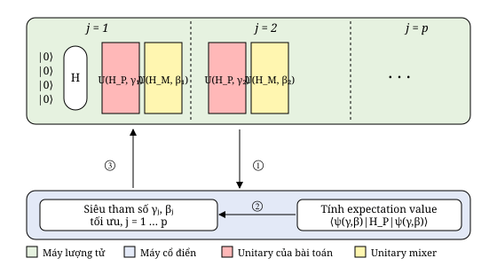
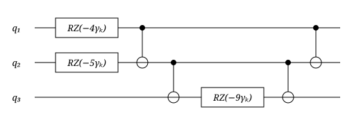
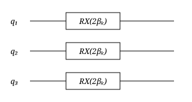

# 6 Tối ưu trên máy gate-based (Optimization in a Gate-based Machine)

*Quantum Approximate Optimization Algorithm* (QAOA) là một trong những kỹ thuật tối ưu lượng tử được đề xuất và nghiên cứu gần đây trên các máy tính lượng tử gate-based [20]. Đây là một thuật toán lượng tử lai, gồm cả phần lượng tử lẫn phần cổ điển. Phần lượng tử gồm một mạch có tham số, được dùng để lấy mẫu các lời giải của bài toán đang giải, còn phần cổ điển chịu trách nhiệm tối ưu các tham số của phần lượng tử nhằm tăng xác suất lấy mẫu được các lời giải tốt nhất. Đi sâu vào chi tiết hơn, phần lượng tử của QAOA là một dạng *variational quantum circuit*, còn gọi là *ansatz*, gồm một số $p$ cho trước các lớp, trong đó mỗi lớp được mô tả bởi tích của hai phép biến đổi unitary $U(H_P, \gamma_k) = e^{-i\gamma_k H_P}$ và $U(H_M, \beta_k) = e^{-i\beta_k H_M}$. Phép thứ nhất phụ thuộc vào bài toán tối ưu cần giải, $H_P$, còn phép thứ hai không phụ thuộc bài toán và dựa trên cái gọi là *mixer Hamiltonian* $H_M$, là tổng các cổng NOT áp dụng lên mọi qubit: $H_M = \sum_{j=1}^{n} X_j$. Vai trò của $U(H_M, \beta_k)$ là tăng xác suất đo được các lời giải chất lượng cao. Ansatz của QAOA được cho bởi phương trình sau:

$$\left|\psi_{(\gamma, \beta)}\right\rangle = \left( \prod_{k=p}^{1} U(H_M, \beta_k)\, U(H_P, \gamma_k) \right) H^{\otimes n} |0\rangle, \tag{41}$$

trong đó Hamiltonian của bài toán $H_P$ là một ma trận đường chéo mà các trị riêng là các giá trị của hàm mục tiêu: $H_P |x\rangle = f(x) |x\rangle$. Ký hiệu $H^{\otimes n}$ biểu diễn việc áp dụng một cổng Hadamard lên mỗi qubit. Lưu ý rằng trong phương trình (41) các toán tử được viết theo thứ tự ngược với trong mạch (xem Hình 5). Các vector $\beta_k$ và $\gamma_k$ là các tham số của ansatz, sẽ được một bộ tối ưu cổ điển tối ưu để cực tiểu hóa giá trị kỳ vọng của $H_P$ trong trạng thái $|\psi\rangle$:

$$E_{(\gamma, \beta)} = \left\langle \psi_{(\gamma, \beta)} \right| H_P \left| \psi_{(\gamma, \beta)} \right\rangle. \tag{42}$$

> **Đã sửa so với bài gốc:** Bài gốc viết "để **cực đại hóa** giá trị kỳ vọng của $H_P$". Điều này mâu thuẫn với quy ước của bài (mọi hàm mục tiêu được cực tiểu hóa) và với chính mã ở Hình 8–10, vốn cực tiểu hóa giá trị trung bình của hàm mục tiêu. Vì $H_P |x\rangle = f(x)|x\rangle$ nên $E_{(\gamma,\beta)}$ là giá trị trung bình của $f$ trên phân phối mà phép đo cho ra, và ta cần **cực tiểu hóa** $E_{(\gamma,\beta)}$. Bản dịch đã sửa thành "cực tiểu hóa".

Một câu hỏi quan trọng ở điểm này là làm thế nào để biểu diễn hàm mục tiêu $f(x)$ dưới dạng một toán tử đường chéo $H_P$ để đưa vào ansatz. Để làm điều này

<p align="center">
  
  <br>
  <em>Hình 5: Quy trình của QAOA</em>
</p>

ta sẽ dùng quantum gate đường chéo không tầm thường duy nhất mà ta đã thấy: cổng Pauli-Z. Ta đã thấy ở Mục 2 rằng $Z_j |x_j\rangle = (-1)^{x_j} |x_j\rangle$. Do đó ta chỉ cần biểu diễn $f(x)$ theo các biến $s_j = (-1)^{x_j}$, nhận giá trị trong $\{-1, 1\}$. Đây chỉ là một mô hình Ising tổng quát hóa. Ta có thể làm phép thế $x_j = (1 - s_j)/2$ trong $f(x)$ để thu được mô hình Ising tổng quát hóa, rồi thay các biến $s_j$ bằng cổng $Z_j$ để thu được Hamiltonian của bài toán.

**Ví dụ 17.** Hãy xây dựng Hamiltonian của bài toán cho hàm pseudo-Boolean ở cuối Ví dụ 10. Ta thu được Hamiltonian này bằng cách thay $x_j$ bằng toán tử $(I - Z_j)/2$:

$$\begin{aligned} H_P &= -9 + 13\,\frac{(I - Z_1)}{2} + 14\,\frac{(I - Z_2)}{2} + 9\,\frac{(I - Z_3)}{2} \\ &\quad - 18\,\frac{(I - Z_1)}{2} \otimes \frac{(I - Z_2)}{2} - 18\,\frac{(I - Z_1)}{2} \otimes \frac{(I - Z_3)}{2} - 18\,\frac{(I - Z_2)}{2} \otimes \frac{(I - Z_3)}{2} \\ &\quad + 36\,\frac{(I - Z_1)}{2} \otimes \frac{(I - Z_2)}{2} \otimes \frac{(I - Z_3)}{2}. \end{aligned}$$

Khai triển các tensor product, ta được

$$H_P = -2Z_1 - \frac{5}{2} Z_2 - \frac{9}{2}\, Z_1 \otimes Z_2 \otimes Z_3. \tag{43}$$

$\square$

> **Ghi chú người dịch:** Phương trình (43) đã được kiểm tra: tại mọi tổ hợp $x \in \{0,1\}^3$, thay $Z_j \to (-1)^{x_j}$ vào (43) cho đúng giá trị $f(x)$ của Ví dụ 10. Lưu ý (43) có số hạng bậc ba $Z_1 Z_2 Z_3$. Ở gate-based ta xử lý được số hạng này trực tiếp (xem Ví dụ 18 và Hình 6), không cần giảm bậc như với quantum annealer ở Mục 5.1.

Hamiltonian của bài toán $H_P$ sẽ có dạng tổng quát

$$H_P = \sum_{S \subseteq [n]} a_S \bigotimes_{j \in S} Z_j, \tag{44}$$

và phép biến đổi unitary $U(H_P, \gamma_k)$ có thể được viết là

$$U(H_P, \gamma_k) = e^{-i\gamma_k \sum_{S \subseteq [n]} a_S \bigotimes_{j \in S} Z_j} = \prod_{S \subseteq [n]} e^{-i\gamma_k a_S \bigotimes_{j \in S} Z_j}, \tag{45}$$

trong đó ta dùng thực tế rằng các toán tử $Z_j$ và các tensor product của chúng giao hoán với nhau để biến mũ của một tổng thành tích của các mũ. Để xây dựng mạch ứng với $U(H_P, \gamma_k)$, ta cần biểu diễn các số hạng $e^{-i\gamma_k a_S \bigotimes_{j \in S} Z_j}$ bằng các quantum gate.

Hãy bắt đầu với các số hạng tuyến tính trong Hamiltonian của bài toán, tức là các số hạng có dạng $e^{-i\gamma_k h_j Z_j}$. Ta đã thấy ở Mục 2 rằng mũ của một ma trận đường chéo là một ma trận đường chéo. Với các số hạng tuyến tính, ta có

$$e^{-i\gamma_k h_j Z_j} = \begin{pmatrix} e^{-i\gamma_k h_j} & 0 \\ 0 & e^{i\gamma_k h_j} \end{pmatrix} = R_{Z_j}(2\gamma_k h_j), \tag{46}$$

trong đó $R_{Z_j}(2\gamma_k h_j)$ là quantum gate RZ với góc $2\gamma_k h_j$ áp dụng lên qubit $j$.

Bây giờ hãy tập trung vào các số hạng bậc hai $e^{-i\gamma_k J_{j\ell} Z_j \otimes Z_\ell}$. Theo cùng cách khai triển mũ, ta được

$$Z_j \otimes Z_\ell = \begin{pmatrix} 1 & 0 & 0 & 0 \\ 0 & -1 & 0 & 0 \\ 0 & 0 & -1 & 0 \\ 0 & 0 & 0 & 1 \end{pmatrix} \Rightarrow e^{-i\gamma_k J_{j\ell} Z_j \otimes Z_\ell} = \begin{pmatrix} e^{-i\gamma_k J_{j\ell}} & 0 & 0 & 0 \\ 0 & e^{i\gamma_k J_{j\ell}} & 0 & 0 \\ 0 & 0 & e^{i\gamma_k J_{j\ell}} & 0 \\ 0 & 0 & 0 & e^{-i\gamma_k J_{j\ell}} \end{pmatrix} = R_{Z_j Z_\ell}(2\gamma_k J_{j\ell}), \tag{47}$$

trong đó ta dùng quantum gate RZZ có mặt trên một số máy tính lượng tử và trình mô phỏng. Cổng lượng tử RZZ có thể được biểu diễn qua các cổng RZ và CNOT như sau:

$$R_{Z_j Z_\ell}(\alpha) = \mathrm{CNOT}_{j\ell}\; R_{Z_\ell}(\alpha)\; \mathrm{CNOT}_{j\ell}. \tag{48}$$

Một cách tổng quát, một số hạng mũ $e^{-i\gamma_k a_S \bigotimes_{j \in S} Z_j}$ có thể được hiện thực trên máy tính lượng tử bằng mạch

$$e^{-i\gamma_k a_S \bigotimes_{j \in S} Z_j} = \prod_{j=1}^{|S|-1} \mathrm{CNOT}_{S_j, S_{j+1}}\; R_{Z_{S_{|S|}}}(2\gamma_k a_S) \prod_{j=|S|-1}^{1} \mathrm{CNOT}_{S_j, S_{j+1}}, \tag{49}$$

trong đó ta giả sử $S$ là một tập có các phần tử được sắp thứ tự và $S_j$ biểu diễn phần tử thứ $j$ của tập có thứ tự đó.

**Ví dụ 18.** Hãy hiện thực một mạch cho $U(H_P, \gamma_k)$ với $H_P$ cho bởi phương trình (43) của Ví dụ 17. Có một số hạng bậc ba và hai số hạng tuyến tính trong biểu thức của $H_P$, và dùng các cổng CNOT và RZ ta thu được mạch ở Hình 6. $\square$

<p align="center">
  
  <br>
  <em>Hình 6: Mạch cho $U(H_P, \gamma_k)$ với $H_P = -2Z_1 - \frac{5}{2}Z_2 - \frac{9}{2}Z_1 \otimes Z_2 \otimes Z_3$.</em>
</p>

Thành phần cuối cùng của ansatz mà ta cần hiện thực là mixer $U(H_M, \beta_k)$, có biểu thức là

$$U(H_M, \beta_k) = e^{-i\beta_k \sum_{j=1}^{n} X_j} = \prod_{j=1}^{n} e^{-i\beta_k X_j}, \tag{50}$$

trong đó một lần nữa ta dùng tính giao hoán của các cổng NOT để biến mũ của một tổng thành tích của các mũ. Các khối xây dựng của biểu thức trước là các số hạng $e^{-i\beta_k X_j}$, được khai triển như sau:

$$e^{-i\beta_k X_j} = \begin{pmatrix} \cos\beta_k & -i\sin\beta_k \\ -i\sin\beta_k & \cos\beta_k \end{pmatrix} = R_{X_j}(2\beta_k), \tag{51}$$

trong đó $R_{X_j}(2\beta_k)$ là cổng RX với góc $2\beta_k$ cho qubit $j$.

**Ví dụ 19.** Trong một ansatz ba qubit, như ansatz cần cho Ví dụ 17, mixer $U(H_M, \beta_k)$ được cho bởi mạch ở Hình 7. $\square$

<p align="center">
  
  <br>
  <em>Hình 7: Mạch cho $U(H_M, \beta_k)$ của ansatz cần để tối ưu bài toán ở Ví dụ 17 và 18.</em>
</p>

Qiskit là SDK của IBM để mô phỏng và chạy các quantum circuit trên các máy tính lượng tử gate-based của IBM. Hình 8 trình bày mã chính để cực tiểu hóa hàm số nguyên ở Ví dụ 10. Thuật toán COBYLA đã được dùng để cực tiểu hóa hàm mục tiêu trên máy tính cổ điển (dòng 17). Mã để xây dựng quantum circuit nằm ở Hình 9. Nó theo thiết kế thu được ở Ví dụ 18 và 19. Cuối cùng, mã để chạy mạch, lấy mẫu các lời giải và tính giá trị mục tiêu trung bình cho phần lấy mẫu được trình bày ở Hình 10. Lưu ý rằng mã này cần đánh giá hàm bằng biểu thức gốc ở Ví dụ 10 chứ không phải bằng Hamiltonian của bài toán ở Ví dụ 18. Ở Bảng 3 chúng tôi trình bày kết quả của một lần chạy mã. Ta quan sát thấy lời giải tối ưu (000) là lời giải xuất hiện thường xuyên nhất, nhưng có ba lời giải dưới tối ưu khác cũng có số lần xuất hiện cao. (Bảng 3 là kết quả gốc của tác giả, thu được trước khi các lỗi trong mã bị sửa; xem ghi chú bên dưới Bảng 3, trong đó có thêm kết quả chạy lại bằng mã đã sửa.)

```python
# Import Necessary Packages: General and Quantum Simulation
from qiskit.circuit import QuantumCircuit
from qiskit.visualization import plot_histogram
from qiskit_aer import AerSimulator
from scipy.optimize import minimize

# The QAOA's Ansatz Wrapper
def build_ansatz(theta):
    # Omitted

# Classical objective function
def classical_obj_fn(theta, num_executions=1000):
    # Omitted

# The main program: Simulation, Parameters' and Solutions' Optimisation
quantum_device = AerSimulator()
qaoa_optimized_parameters = minimize(classical_obj_fn, [0.1,0.1,0.1,0.1], method='COBYLA')
print(f'Parameters: {qaoa_optimized_parameters}')
final_circuit = build_ansatz(qaoa_optimized_parameters.x)
sampled_solutions = quantum_device.run(final_circuit, shots = 1000).\
                    result().get_counts()
plot_histogram(sampled_solutions)
```

*Hình 8: Mã chính của hiện thực QAOA bằng Qiskit cho chương trình cực tiểu hóa hàm mục tiêu ở Ví dụ 10. (Đã sửa: dùng `AerSimulator()` và tham số `shots`; xem ghi chú bên dưới Bảng 3.)*

```python
# The QAOA's Ansatz Wrapper
def build_ansatz(theta):
  # Parameters of the QAOA's Ansatz
  num_qubits = 3
  qaoa_depth = len(theta)//2
  # Construct the QAOA's Circuit
  circuit = QuantumCircuit(num_qubits)
  gamma = theta[:qaoa_depth]
  beta = theta[qaoa_depth:]
  # Layer of Hadamard gates
  for i in range(0, num_qubits):
    circuit.h(i)
  # Construct QAOA layers
  for i in range(0,qaoa_depth):
    # Unitary depending on problem Hamiltonian
    circuit.rz(-4 * gamma[i],0)
    circuit.rz(-5 * gamma[i],1)
    circuit.cx(0,1)
    circuit.cx(1,2)
    circuit.rz(-9 * gamma[i],2)
    circuit.cx(1,2)
    circuit.cx(0,1)
    # Construct the mixer
    for qbit in range(0,num_qubits):
      circuit.rx(2 * beta[i], qbit)
  # Apply measurement to all qubits
  circuit.measure_all()
  return circuit
```

*Hình 9: Mã để xây dựng ansatz của QAOA cho Ví dụ 10.*

```python
# Classical objective function
def classical_obj_fn(theta, num_executions=1000):
  # Objective function to evaluate after sampling
  def objective_function(x):
    return -9 +13*x[0] +14*x[1] +9*x[2] \
           -18*x[0]*x[1] -18*x[0]*x[2] -18*x[1]*x[2] \
           +36*x[0]*x[1]*x[2]

  # Create the Ansatz
  circuit = build_ansatz(theta)
  # Execute the Circuit
  sampled_solutions = quantum_device.run(circuit, shots = num_executions).\
                      result().get_counts()
  # Compute the average value of the objective function for sampled solutions
  value = 0
  sampled = 0
  for solution, occurrences in sampled_solutions.items():
    # Invert and transform the solution because it is a string
    # Element 0 is at position n-1, element 1 is at posicion n-2, etc.
    x=[int(v) for v in solution[::-1]]
    value += objective_function(x) * occurrences
    sampled += occurrences
  return value/sampled
```

*Hình 10: Mã để lấy mẫu ansatz và tính giá trị trung bình của hàm mục tiêu trên các mẫu, cho Ví dụ 10. (Đã sửa: `value +=` ở dòng 21 và tham số `shots`; xem ghi chú bên dưới Bảng 3.)*

*Bảng 3: Kết quả gốc của tác giả, thu được sau khi chạy QAOA bằng mã ở Hình 8 đến 10 **trước khi sửa**.*

| Solution | Occurrences | Solution | Occurrences |
|:-:|:-:|:-:|:-:|
| 000 | 248 | 100 | 36 |
| 001 | 52 | 101 | 199 |
| 010 | 9 | 110 | 169 |
| 011 | 200 | 111 | 111 |

> **Đã sửa so với bài gốc (mã ở Hình 8 và 10, và cách đọc Bảng 3):**
> 1. **Hình 10, dòng 21: `value =` đã sửa thành `value +=`.** Trong PDF gốc, dòng này là `value = objective_function(x) * occurrences`. Với dấu `=`, biến `value` bị ghi đè ở mỗi vòng lặp nên hàm trả về giá trị của *chỉ lời giải cuối cùng* trong từ điển (nhân số lần xuất hiện, chia tổng số mẫu), chứ không phải giá trị trung bình có trọng số như chú thích trong mã ("average value of the objective function"). Hàm mục tiêu sai này khiến COBYLA tối ưu nhầm thứ.
> 2. **Hình 8 và 10: `nshots` đã sửa thành `shots`.** `nshots` không phải tham số hợp lệ của Qiskit Aer; tham số lạ bị bỏ qua và Aer dùng số lần đo mặc định là 1024. Đã kiểm tra bằng cách chạy thử: `run(circuit, nshots=1000)` cho tổng 1024 mẫu, còn `run(circuit, shots=1000)` cho tổng 1000. Bảng 3 gốc cũng củng cố điều này: $248 + 52 + 9 + 200 + 36 + 199 + 169 + 111 = 1024$.
> 3. **Hình 8: `Aer.get_backend('qasm_simulator')` đã đổi thành `AerSimulator()`.** Cách gọi cũ vẫn chạy được nhưng Qiskit Aer (bản 0.18.2, lúc kiểm tra) cảnh báo `QasmSimulator` sẽ bị loại bỏ trong tương lai và được thay bằng `AerSimulator`.
> 4. **Thứ tự bit (không phải lỗi, chỉ cần lưu ý khi đọc kết quả).** Qiskit dùng thứ tự little-endian: qubit 0 nằm ở **ngoài cùng bên phải** của chuỗi bit kết quả. Mã dùng `solution[::-1]` để đảo lại, đúng với việc $x_1$ ứng với qubit 0. Vì vậy, nếu cột Solution của Bảng 3 là khóa thô của Qiskit thì cần đọc ngược chuỗi bit để ra $(x_1, x_2, x_3)$.
>
> **Bảng 3 được giữ nguyên.** Bảng 3 là dữ liệu mà tác giả thu được bằng mã gốc (còn lỗi), nên bản dịch không thay số liệu. Giá trị trung bình của hàm mục tiêu trên phân phối trong Bảng 3 (đọc khóa theo thứ tự thô của Qiskit) xấp xỉ $-2{,}6$ và xác suất đo được lời giải tối ưu (000) khoảng 24%.
>
> **Kết quả chạy lại bằng mã đã sửa (do người dịch chạy, không phải của tác giả gốc).** Môi trường: Qiskit 2.6.2, Qiskit Aer 0.18.2; $p = 2$ lớp, tham số khởi đầu $[0.1, 0.1, 0.1, 0.1]$, COBYLA, 1000 shots mỗi lần đánh giá, `seed_simulator` cố định. Kết quả lấy mẫu 1000 lần với tham số tối ưu tìm được:
>
> | Khóa Qiskit | $(x_1, x_2, x_3)$ | $f(x)$ | Occurrences |
> |:-:|:-:|:-:|:-:|
> | 000 | (0, 0, 0) | −9 | 312 |
> | 110 | (0, 1, 1) | −4 | 285 |
> | 101 | (1, 0, 1) | −5 | 166 |
> | 011 | (1, 1, 0) | 0 | 147 |
> | 010 | (0, 1, 0) | 5 | 41 |
> | 100 | (0, 0, 1) | 0 | 27 |
> | 001 | (1, 0, 0) | 4 | 16 |
> | 111 | (1, 1, 1) | 9 | 6 |
>
> Giá trị trung bình của hàm mục tiêu xấp xỉ $-4{,}5$ (so với $-2{,}6$ ở Bảng 3 gốc), lời giải tối ưu $(0,0,0)$ chiếm khoảng 31%, và lời giải tệ nhất $(1,1,1)$ chỉ còn khoảng 0,6% (so với 11% ở Bảng 3 gốc). Hai lời giải tốt tiếp theo, $(1,0,1)$ với $f = -5$ và $(0,1,1)$ với $f = -4$, cũng xuất hiện nhiều. Cần lưu ý đây chỉ là một lần chạy: COBYLA chạy trên hàm mục tiêu có nhiễu thống kê do lấy mẫu hữu hạn, nên số liệu thay đổi giữa các lần chạy. Mã đầy đủ để tự chạy lại nằm trong [notebooks/A-examples/05-qaoa-integer-function.ipynb](../../notebooks/A-examples/05-qaoa-integer-function.ipynb), gồm cả so sánh trực tiếp giữa mã gốc và mã đã sửa.
